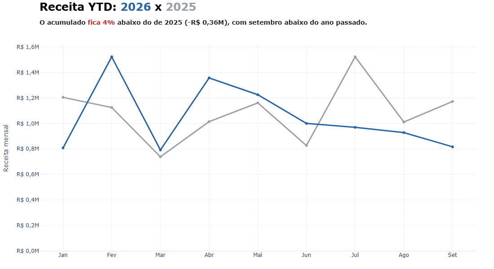
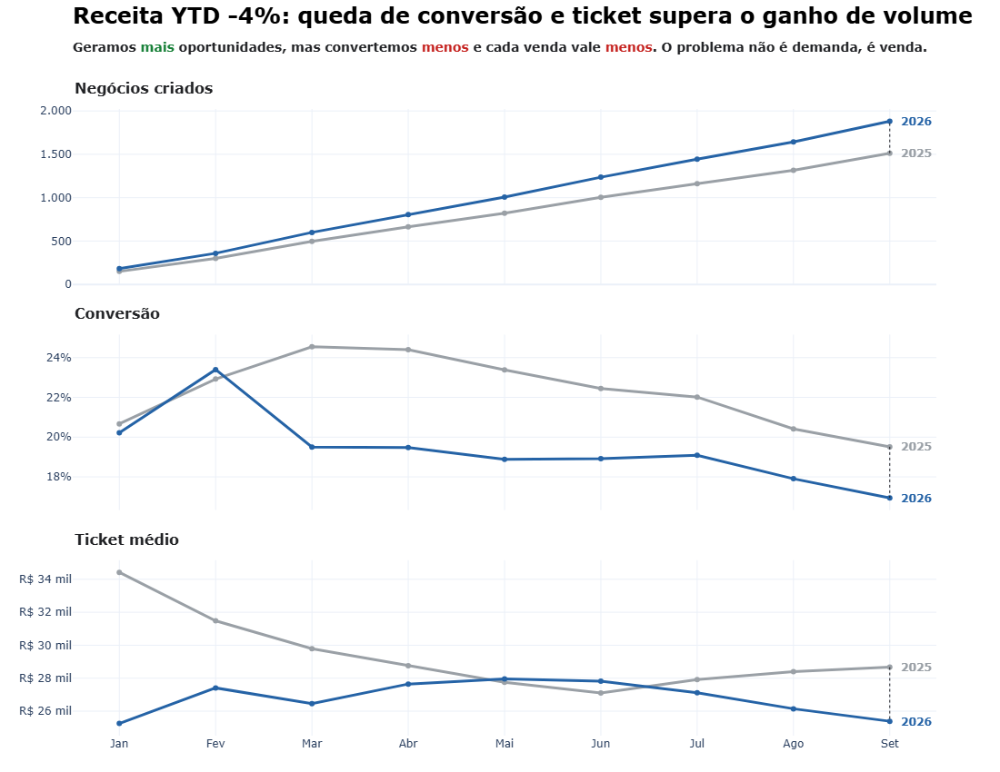
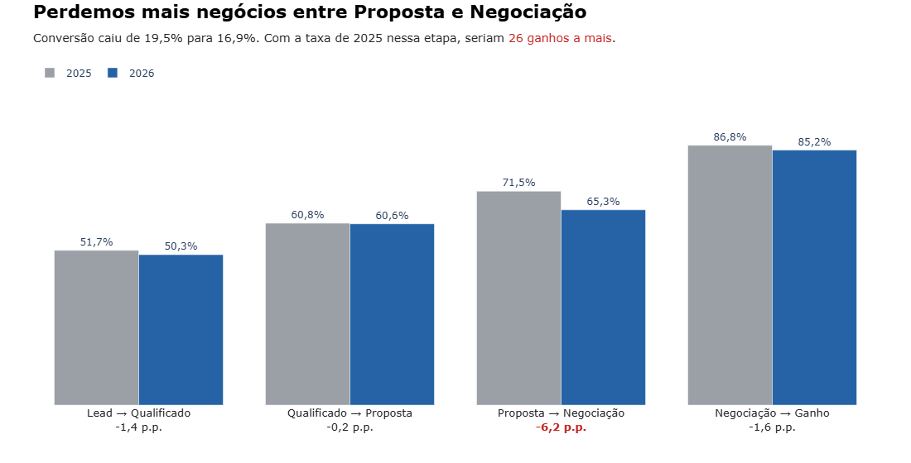
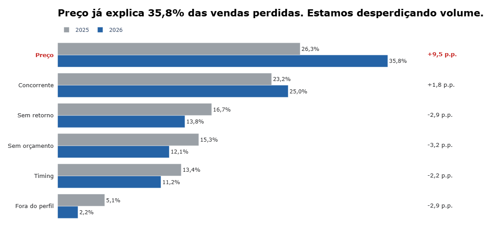
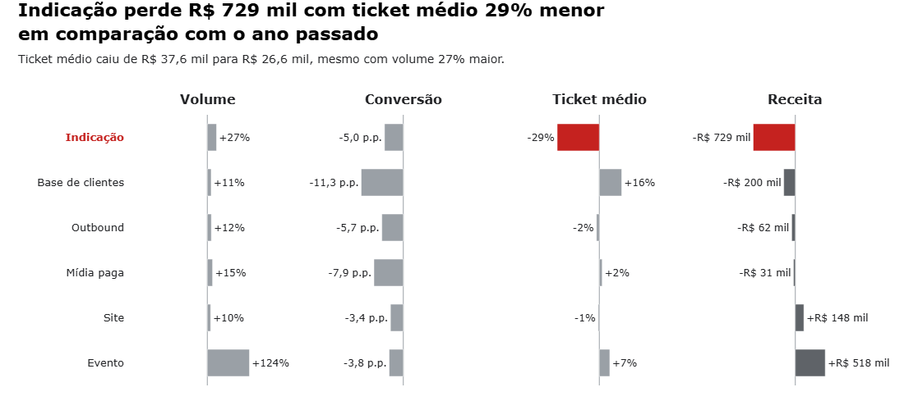
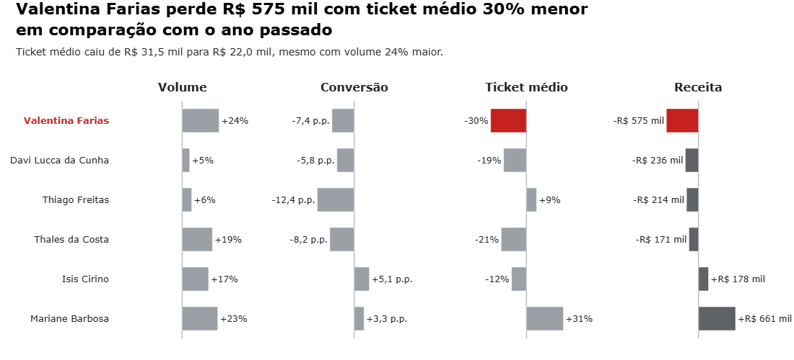
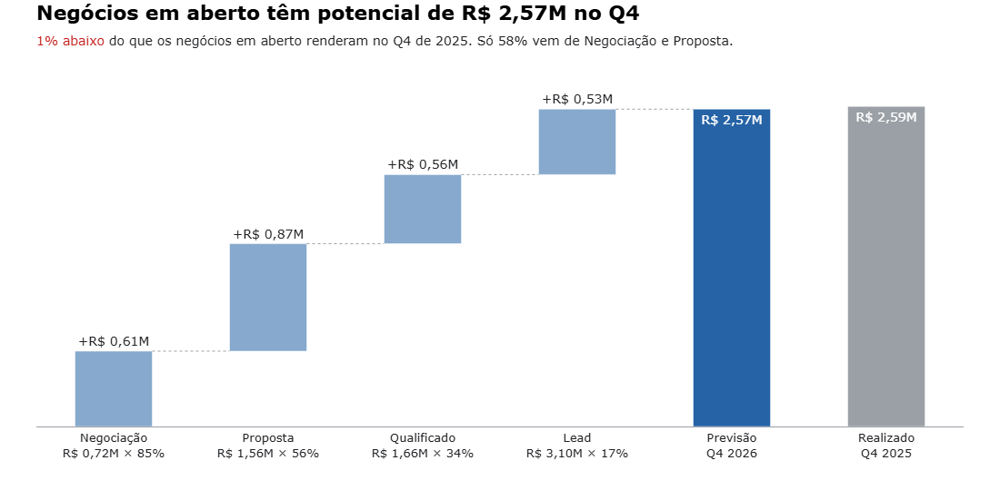

# Storytelling do Funil Comercial

> Os dados utilizados foram gerados com Faker e NÃO são reais!

## Cenário

Empresa B2B de software de gestão para PMEs. 
No fechamento de setembro de 2026, o diretor comercial precisa responder:
o comercial está melhor ou pior que em 2025?

## A receita cai a partir de julho

De fevereiro a junho, 2026 rendeu mais que 2025 todos os meses. 
Porém, a partir de julho, começamos a render menos em todos os meses: 
R\$ 0,97M contra R\$ 1,52M em julho e R\$ 0,82M contra R\$ 1,17M em setembro (30% menos).

O acumulado até setembro ficou 4% abaixo do de 2025 (-R\$ 0,36M).

## A demanda cresceu, mas vendemos pior

Criamos 1.882 negócios até setembro, 24% a mais que os 1.513 de 2025.

Mas convertemos menos: a conversão caiu de 19,5% para 16,9% (-2,6 p.p.) e ficou abaixo de 2025 desde março.
O ticket médio também caiu, de R\$ 28,7 mil para R\$ 25,4 mil (-11%), e se afasta de 2025 desde julho.

Mais volume não compensou a queda de conversão e de ticket. É nessa queda que a receita foi perdida.

A receita caiu só 4% porque o volume compensa boa parte: +24% de negócios, contra -13% de conversão e -11% de ticket
(1,24 × 0,87 × 0,89 ≈ 0,96).

O desconto médio quase não mudou (7,5% para 7,8%). O ticket caiu porque os negócios fechados são menores: o valor
estimado médio caiu 11%.

A conversão compara os negócios criados de janeiro a setembro, vistos em 30/09 de cada ano: 196 seguiam em aberto em
2025 e 247 em 2026. Os demais negócios foram perdidos ainda no Lead (636 em 2025 e 813 em 2026) e ficam fora da
análise de motivos, que olha as perdas após o lead.

## A conversão cai na proposta

A conversão de lead a ganho caiu de 19,5% para 16,9%. Para achar onde, olhamos cada etapa do funil.

Quem chega à negociação ainda fecha quase como antes. O problema está antes: a proposta deixou de avançar.

Esses 26 ganhos a mais valeriam cerca de R\$ 0,66M ao ticket médio de 2026 (R\$ 25,4 mil), quase o dobro da diferença de
R\$ 0,36M no acumulado. Recuperar só essa etapa cobriria a queda de receita.

## A perda vem do preço

O preço lidera o aumento das perdas. As perdas após o lead subiram de 424 para 545 (+121). Perdemos 195 negócios por
preço em 2026, 80 a mais que em 2025: dois terços do aumento. Concorrente responde por outros 37.

Preço e Concorrente juntos pesam em 60,7% das perdas. O preço é o principal candidato a explicar por que as propostas
deixaram de avançar.

## O canal de Indicação concentra a perda

A perda não está espalhada pelos canais. Indicação perdeu R\$ 729 mil, o dobro da queda total de R\$ 0,36M.
O que segura o resultado é Evento: com volume 124% maior, trouxe R\$ 518 mil a mais. Sem ele, a queda seria de R\$ 0,87M.

Em Indicação, o volume cresceu 27% e o ticket caiu 29%: trouxemos mais negócios, porém menores. O valor estimado médio
caiu de R\$ 40,7 mil para R\$ 28,9 mil e o desconto subiu só 1,9 p.p. (6,7% para 8,6%). A conversão caiu apenas 2,0 p.p.:
a perda de Indicação é de ticket.

## Mesmo volume, resultados opostos

O gráfico considera só os negócios que chegaram a Qualificado, por isso a conversão de cada vendedor não é comparável
com a conversão total. Quatro dos seis vendedores perderam receita. A maior queda é a de Valentina Farias (-R\$ 575 mil), maior que a queda total
de R\$ 0,36M.

Com crescimento de volume parecido (+24% e +23%), Mariane Barbosa fez o oposto: elevou a conversão (+3,3 p.p. contra
-7,4 p.p.), subiu o ticket em 31%, contra queda de 30%, e trouxe R\$ 661 mil a mais. O volume não explica a diferença.

## O Q4 não deve compensar a queda

Os negócios em aberto chegam ao Q4 no mesmo patamar de 2025. Sem folga, o trimestre não deve compensar a diferença de
R\$ 0,36M do acumulado.

A Proposta é a etapa que mais pesa na previsão (R\$ 0,87M) e a que mais perdeu conversão. É onde agir primeiro no Q4.
