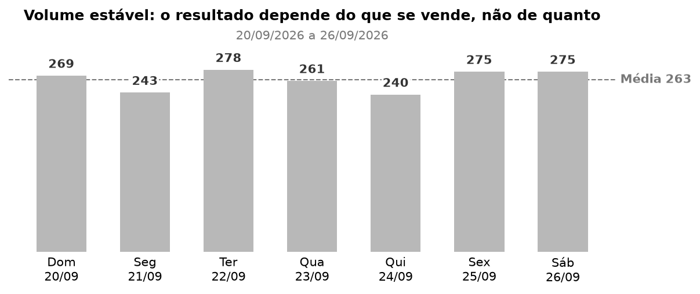
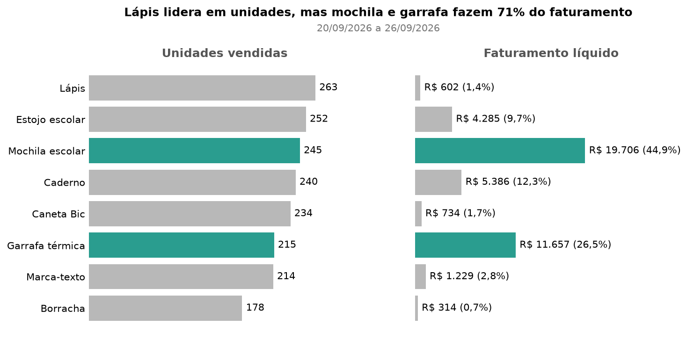
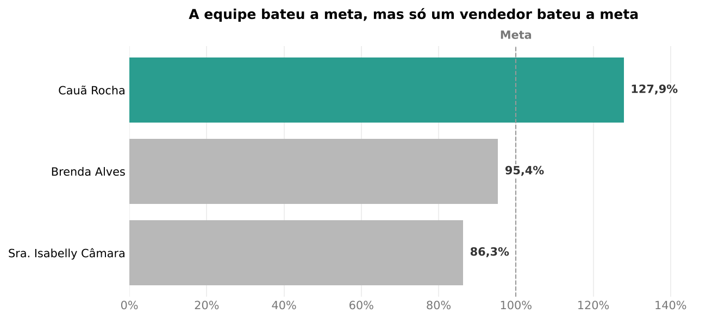
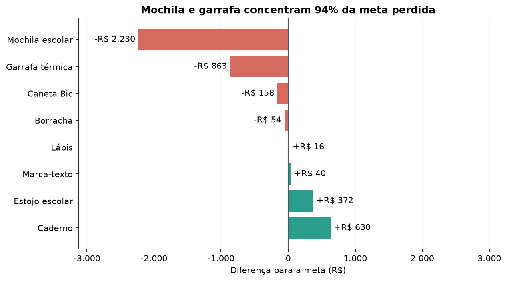

# Storytelling do Ranking de Produtos

> Os dados utilizados foram gerados com Faker e NÃO são reais!

## Cenário

Fechamento semanal: o gestor confere vendas, metas e produtos de 20/09 a 26/09/2026.

Os exemplos abaixo mostram os gráficos gerados pela automação para o período analisado.

## Qual foi o ritmo de vendas nessa semana?

Mostra a quantidade total de unidades vendidas em cada dia, facilitando a comparação do movimento ao longo da semana.

Foram 1.841 unidades na semana, entre 240 e 278 por dia, com média de 263. Não houve dia fora do padrão: o que muda
o resultado é quais produtos se vendem.

## Quais produtos mais venderam e qual o impacto das vendas na receita?

Compara, lado a lado, as unidades vendidas e o faturamento líquido de cada produto. Mostra que volume alto não significa
receita alta.

O lápis vende mais unidades (263), mas responde por 1,4% do faturamento. Mochila escolar e Garrafa térmica somam 71%
(R\$ 31.363) e são os produtos que mais pesam no resultado.

## E o desempenho dos vendedores nessa semana?

Compara, em reais, o faturamento líquido de cada vendedor com sua meta. Ajuda a ver quem atingiu ou ficou abaixo da meta.

Cauã Rocha atingiu 127,9% da meta (R\$ 15.934 contra R\$ 12.456). Brenda Alves ficou em 95,4% (R\$ 735 abaixo) e
Sra. Isabelly Câmara em 86,3% (R\$ 2.029 abaixo).

## Algum produto não atingiu a meta de faturamento semanal?

Apresenta quanto cada produto ficou acima ou abaixo da meta de faturamento, em reais.

Quatro produtos ficaram, juntos, R\$ 3.305 abaixo da meta. Mochila escolar e Garrafa térmica respondem por 94% desse
valor e são os que pedem atenção.
